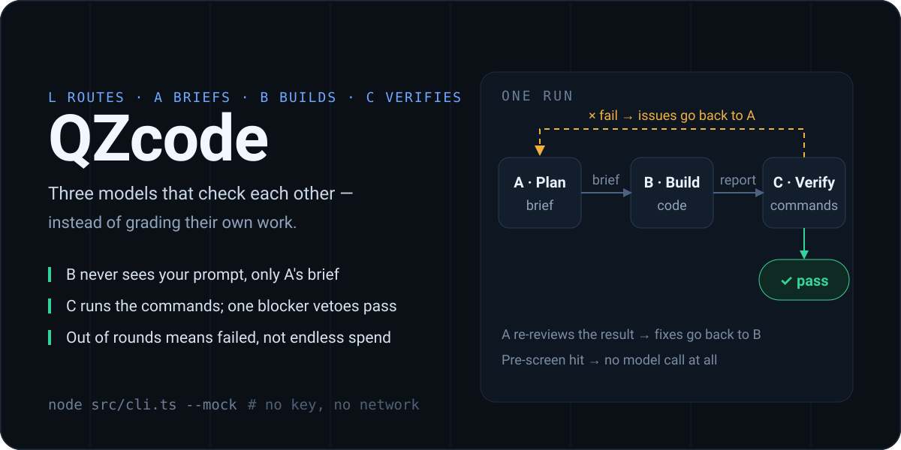

<p align="right"><a href="./README.md">简体中文</a> · <strong>English</strong></p>

<p align="center"></p>

**Three models, none of them allowed to grade its own work.**

B never sees your prompt — only the brief A wrote. C ignores B's report and opens the files and runs the commands itself. One `blocker` from C and the round does not pass. The TUI, `qzcode run` and the VS Code sidebar all drive the same pipeline.

## Up and running in three steps

### 1. Watch the whole loop offline (no key needed)

```bash
git clone https://github.com/<you>/qzcode && cd qzcode
node src/cli.ts --mock
```

`--mock` uses a scripted model and runs L→A→B→C for two rounds (the first round deliberately fails), so you can see what "sent back for fixes" looks like. Requires Node ≥ 22.19: the repo runs `.ts` directly, no build step.

### 2. Point it at real models

```bash
node src/cli.ts init            # writes ./qzcode.json
export DEEPSEEK_API_KEY=sk-xxx  # or edit roles.*.apiKey
node src/cli.ts run "add parseDuration to src/utils.ts and cover it with tests"
```

- No subcommand means the TUI: three panes so you can watch A / B / C at the same time.
- Every request hits a cheap router first: questions get answered directly, A/B/C never start (~1k tokens vs 7k+ for the full loop in our own runs).
- Each role is configured separately (DeepSeek for A, Kimi for B, local Ollama for C — anything as long as the endpoint speaks OpenAI-compatible `/chat/completions` with streaming and function calling).

### 3. Install it in your editor (the main entry point)

```bash
npm run bundle:backend
node node_modules/@vscode/vsce/vsce package --allow-missing-repository --no-dependencies --skip-license -o qzcode.vsix --cwd vscode
code --install-extension qzcode.vsix --force
```

A QZcode icon shows up in the secondary sidebar → type a goal → Enter. The backend ships inside the extension, so there is no clone and no `npm install`; Node ≥ 18 is enough (only running `.ts` from the repo needs 22.19).

## Who does what

| Role | Suggested model | Job | What it never gets |
| --- | --- | --- | --- |
| **L** `leader` | the cheapest one | Decide whether this request deserves the pipeline; answer plain questions itself | — |
| **A** `planner` | any strong model | Write the brief plus executable acceptance criteria; re-review B and emit concrete fixes when it drifts | Write or exec access |
| **B** `implementer` | strong with tools | Edit code, run commands, report back — from the brief alone | **Your prompt**, the acceptance criteria |
| **C** `verifier` | a reasoning model | Read-only checks plus running the commands itself, returning `pass` / `issues` / `evidence` | Any write access |

When rounds run out the run ends as `failed` instead of spending forever. If `issues` contains a `blocker`, a model-written `pass: true` is still a fail.

## Configuration

The `qzcode.json` that `node src/cli.ts init` writes (built-in defaults are used when no config is found):

```json
{
  "maxRounds": 3,
  "maxSteps": 40,
  "exec": { "enabled": true, "timeoutMs": 300000 },
  "review": { "enabled": true, "maxCorrections": 2 },
  "roles": {
    "leader":      { "provider": "deepseek", "model": "deepseek-chat",     "apiKey": "${DEEPSEEK_API_KEY}" },
    "planner":     { "provider": "deepseek", "model": "deepseek-chat",     "apiKey": "${DEEPSEEK_API_KEY}" },
    "implementer": { "provider": "deepseek", "model": "deepseek-chat",     "apiKey": "${DEEPSEEK_API_KEY}" },
    "verifier":    { "provider": "deepseek", "model": "deepseek-reasoner", "apiKey": "${DEEPSEEK_API_KEY}" }
  }
}
```

- Presets: `deepseek` / `openai` / `openrouter` / `moonshot` / `zhipu` / `ollama` / `lmstudio`. A `baseUrl` overrides the preset, and **any other name plus a `baseUrl` is a custom gateway**.
- `${VAR}` and `${VAR:-fallback}` expand; `localhost` endpoints get a placeholder key.
- To spend less: `review.enabled: false` drops the A re-review call, `leader.enabled: false` drops the router.

## Plugins

List paths in `plugins[]`; both styles load, and the host hands them the same object:

```ts
// pi style
export default function (pi) {
  pi.registerTool({ name: 'count_lines', description: 'count lines', parameters: { type: 'object', properties: {} }, execute: () => ({ content: 'N lines' }) })
  pi.on('tool_call', (e) => (e.toolName === 'bash' && /rm\s+-rf/.test(e.input?.command) ? { block: true, reason: 'refused' } : undefined))
  pi.on('tool_result', (e) => (e.toolName === 'read' ? { output: e.output.replace(/KEY=\S+/g, 'KEY=***') } : undefined))
}

// cordis style
export default {
  name: 'my-plugin',
  inject: ['tools'],
  apply(ctx) {
    ctx.get('tools').register({ name: 'hello', readOnly: true, parameters: {}, run: () => ({ ok: true, output: 'hi' }) })
  },
}
```

`tool_call` really blocks a call and `tool_result` really rewrites what the model sees, so extensions like "guard .env" or "audit every bash command" do take effect. Full API: [docs/plugins.md](docs/plugins.md).

## Command reference

| Command | What it does |
| --- | --- |
| `qzcode` (or `node src/cli.ts`) | TUI |
| `qzcode run "goal"` | One-shot run, plain-text output (`--json` for JSON) |
| `qzcode init` | Write `qzcode.json` |
| `qzcode config` | Print endpoints / models / masked keys per role |
| `qzcode plugins` | Loaded plugins and where they came from |
| `qzcode web --no-open` | Start the local backend only (this is what the extension drives; `/api/*` only, no pages) |

Common flags: `-w/--workspace`, `-r/--rounds`, `--no-exec`, `--mock`, `-d/--debug`.

## Limits

- OpenAI-compatible protocol only; point Anthropic / Gemini at their compatible endpoints.
- C's read-only access is a tool allowlist plus prompt discipline, not kernel isolation. For hard isolation, containerize.
- The workspace sandbox blocks path escapes only; it does not stop a command from doing damage — use `--no-exec` when unsure.
- No automatic context compaction: cap long tasks with `maxRounds` / `maxSteps`, or use a long-context model.
- `web` has no auth and listens on loopback by default; add a firewall or proxy if you use `--host 0.0.0.0`.

## More

- [docs/architecture.md](docs/architecture.md): data flow, the Reporter protocol, failures and cancellation, security boundaries
- [docs/plugins.md](docs/plugins.md): plugin API, event list, tool shapes
- [docs/skills.md](docs/skills.md): skills (per-role methodology, importable)
- [docs/pi-alignment.md](docs/pi-alignment.md): item-by-item comparison with [pi](https://github.com/earendil-works/pi) and what is intentionally missing
- [docs/manual.zh.md](docs/manual.zh.md): the long-form manual (Chinese; TUI keys, layout, tests)

Zero runtime dependencies — only Node built-ins. `npm run check` is typecheck plus tests.

MIT © QZzwj
