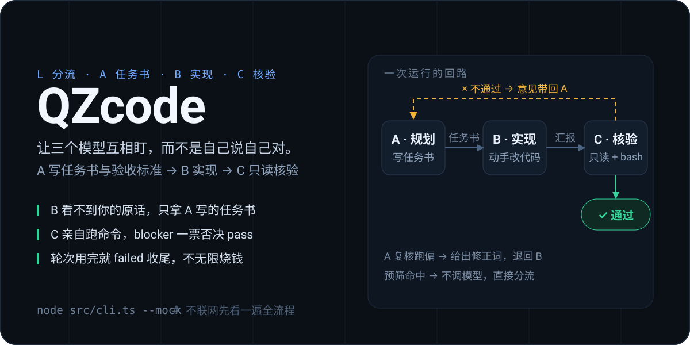

<p align="right"><strong>简体中文</strong> · <a href="./README.en.md">English</a></p>

<p align="center"></p>

<p align="center"><a href="https://github.com/QZzwj/QZcode/releases/latest/download/qzcode.vsix"></a></p>

**三个模型分工，谁都不能自己说自己对。**

B 看不到你的原话，只读 A 写的任务书；C 不信 B 的汇报，自己开文件、自己跑命令；只要 C 记一条 `blocker`，这一轮就不算通过。TUI、`run` 和 VS Code 侧栏三个入口，用的是同一条流水线。

## 三步跑起来

### 1. 不联网先看一遍（不需要 key）

```bash
git clone https://github.com/QZzwj/QZcode && cd QZcode
node src/cli.ts --mock
```

`--mock` 用脚本化模型跑完 L→A→B→C 两轮（第一轮故意不通过），直接看到"退回修正"长什么样。需要 Node ≥ 22.19（仓库里直接跑 `.ts`，不用编译）。

### 2. 接上真模型

```bash
node src/cli.ts init            # 生成 ./qzcode.json
export DEEPSEEK_API_KEY=sk-xxx  # 或者直接改 roles.*.apiKey
node src/cli.ts run "给 src/utils.ts 加 parseDuration 并补测试"
```

- 不带子命令就是 TUI：三个面板并排看 A / B / C 各自在干什么。
- 先过一次分流：问答类目标直接答完，A/B/C 一次都不跑（实测约 1k token vs 完整流程 7k+）。
- 三个角色可以分别配（A 用 DeepSeek、B 用 Kimi、C 用本地 Ollama 都行），只要端点是 OpenAI 兼容的 `/chat/completions`（流式 + function calling）。

### 3. 装进编辑器（主入口）

不想自己打包，就直接下 [Release 里的 `qzcode.vsix`](https://github.com/QZzwj/QZcode/releases/latest/download/qzcode.vsix)，在扩展面板右上 `⋯` → **从 VSIX 安装**。要从源码打一份：

```bash
npm run bundle:backend
cd vscode
node ../node_modules/@vscode/vsce/vsce package --allow-missing-repository --no-dependencies --skip-license -o ../qzcode.vsix
cd ..
code --install-extension qzcode.vsix --force
```

右侧栏出现 QZcode 图标 → 输入目标 → Enter。后端打在扩展里，**不需要克隆仓库、不需要 npm install**，Node ≥ 18 即可（仓库里直接跑 `.ts` 才要 22.19）。

## 谁在干什么

| 角色 | 建议模型 | 负责 | 它拿不到 |
| --- | --- | --- | --- |
| **L** `leader` | 最便宜的 | 判断这条请求值不值得动流水线；问答自己答完 | — |
| **A** `planner` | 任意强模型 | 写任务书 + 可执行的验收标准；B 跑偏时先复核，给出可直接执行的修正词 | 写权限、执行权限 |
| **B** `implementer` | 工具调用强的 | 照任务书改代码、跑命令、交汇报 | **你的原话**、验收标准 |
| **C** `verifier` | 推理型 | 只读核验 + 亲自跑命令，出 `pass` / `issues` / `evidence` | 任何写权限 |

轮次用完就以 `failed` 收尾，不会无限烧钱；`issues` 里出现 `blocker` 时，模型自己写 `pass: true` 也算不通过。

## 编辑器里几个用得上的开关

- **先看任务书**：勾上输入框旁的「先看任务书」再发目标，A 只出任务书就停；点「按这个做」继续，跳过 L 和 A 直接进 B（省掉这两步的 token）。
- **`@文件`**：目标里写 `@src/utils.ts`，后端把文件内容附给 A；越界、不存在、二进制会给出原因，超长会截断。
- **接着改**：上一轮的目标、结论和改动清单会带进下一轮，不用每次从零解释。
- **改动可回滚**：动手前先存快照，跑完点「查看改动」「回滚某个文件」「全部回滚」，也可用命令面板的 `QZcode: 回滚本次运行的文件改动`；「查看本轮记录」打开 `.qzcode/runN.md`。
- **预算硬闸**：`cost.dailyBudget` 按天记账（`.qzcode/cost.json`），花超了直接拒绝开新一轮；成本页有进度条。

## 配置

`node src/cli.ts init` 生成的 `qzcode.json`（找不到配置就用内置默认值）：

```json
{
  "maxRounds": 3,
  "maxSteps": 40,
  "exec": { "enabled": true, "timeoutMs": 300000 },
  "review": { "enabled": true, "maxCorrections": 2 },
  "roles": {
    "leader":      { "provider": "deepseek", "model": "deepseek-chat",     "apiKey": "${DEEPSEEK_API_KEY}" },
    "planner":     { "provider": "deepseek", "model": "deepseek-chat",     "apiKey": "${DEEPSEEK_API_KEY}" },
    "implementer": { "provider": "deepseek", "model": "deepseek-chat",     "apiKey": "${DEEPSEEK_API_KEY}" },
    "verifier":    { "provider": "deepseek", "model": "deepseek-reasoner", "apiKey": "${DEEPSEEK_API_KEY}" }
  }
}
```

- 预设：`deepseek` / `openai` / `openrouter` / `moonshot` / `zhipu` / `ollama` / `lmstudio`；填 `baseUrl` 就覆盖预设，**随便起个名字 + `baseUrl` 就是自定义网关**。
- `${VAR}` 和 `${VAR:-缺省值}` 会展开；`localhost` 端点自动补占位 key。
- 想省钱：`review.enabled: false` 少一次 A 复核调用，`leader.enabled: false` 不起分流。
- 其它几块：`cost.dailyBudget`（每日预算，0 = 不限）、`git.autoCommit`（每轮结束自动提交改动）、`vision.*`（把截图交给视觉模型看，C 是纯文本模型时用得上）、`skills.*`（技能开关与导入）。

## 插件

配置里 `plugins[]` 写路径即可，两种写法都收（宿主传给插件的是同一个对象）：

```ts
// pi 格式
export default function (pi) {
  pi.registerTool({ name: 'count_lines', description: '统计行数', parameters: { type: 'object', properties: {} }, execute: () => ({ content: 'N 行' }) })
  pi.on('tool_call', (e) => (e.toolName === 'bash' && /rm\s+-rf/.test(e.input?.command) ? { block: true, reason: '拒绝' } : undefined))
  pi.on('tool_result', (e) => (e.toolName === 'read' ? { output: e.output.replace(/KEY=\S+/g, 'KEY=***') } : undefined))
}

// cordis 格式
export default {
  name: 'my-plugin',
  inject: ['tools'],
  apply(ctx) {
    ctx.get('tools').register({ name: 'hello', readOnly: true, parameters: {}, run: () => ({ ok: true, output: 'hi' }) })
  },
}
```

`tool_call` 能真的拦住调用，`tool_result` 能改写模型看到的结果——"保护 .env""审计所有 bash 命令"这类扩展是真能生效的。完整 API 见 [docs/plugins.md](docs/plugins.md)。

## 命令速查

| 命令 | 作用 |
| --- | --- |
| `qzcode`（或 `node src/cli.ts`） | TUI |
| `qzcode run "目标"` | 一次性运行，纯文本输出（加 `--json` 出 JSON） |
| `qzcode init` | 生成 `qzcode.json` |
| `qzcode config` | 打印三个角色的端点 / 模型 / key 掩码 |
| `qzcode plugins` | 已加载插件及来源 |
| `qzcode web --no-open` | 只起本地后端（扩展用的就是它，只有 `/api/*`，没有页面） |

常用开关：`-w/--workspace`、`-r/--rounds`、`--no-exec`、`--mock`、`-d/--debug`。

## 边界

- 只接 OpenAI 兼容协议：Anthropic / Gemini 请用它们的兼容端点。
- C 的"只读"靠工具白名单 + 提示词约束，不是内核级隔离；要硬隔离请容器化。
- 工作区沙箱只防路径越界，不防命令本身干坏事——不确定就 `--no-exec`。
- 不做上下文自动压缩，长任务靠 `maxRounds` / `maxSteps` 兜，或换长上下文模型。
- `web` 不做鉴权，默认只监听回环地址；`--host 0.0.0.0` 时请自己加防火墙或反代。

## 更多

- [docs/architecture.md](docs/architecture.md)：数据流、Reporter 协议、失败与取消、安全边界
- [docs/plugins.md](docs/plugins.md)：插件 API、事件表、工具形状
- [docs/skills.md](docs/skills.md)：技能（按角色追加的方法论，可导入自定义）
- [docs/pi-alignment.md](docs/pi-alignment.md)：与 [pi](https://github.com/earendil-works/pi) 的逐项对照与"有意不做"
- [docs/manual.zh.md](docs/manual.zh.md)：完整手册（TUI 键位、目录结构、测试）

零运行时依赖，只用 Node 自带模块；`npm run check` 是 typecheck + 测试。

MIT © QZzwj
