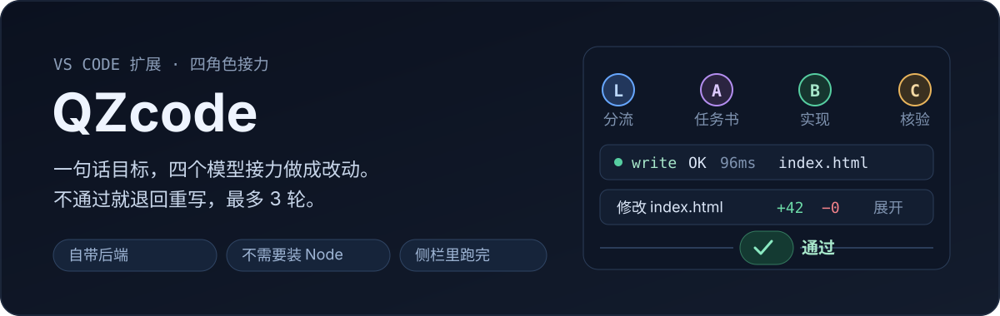
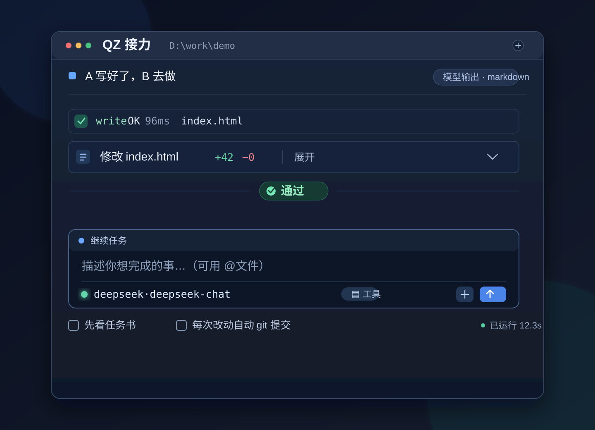
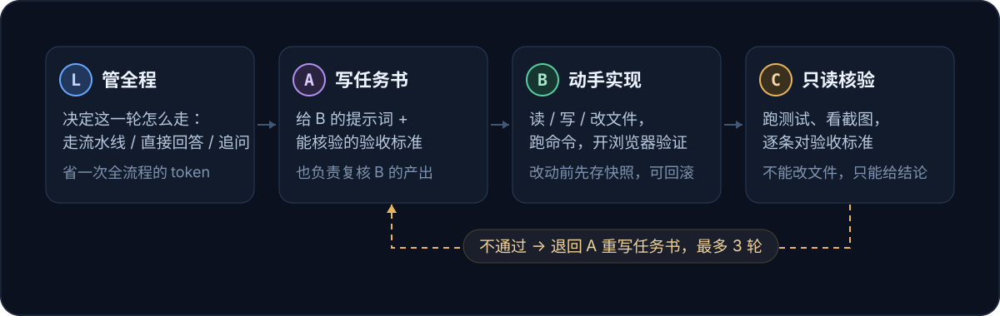

<p align="center">
  
</p>

<p align="center">
  <a href="https://github.com/QZzwj/QZcode/releases/latest"></a>
  <a href="https://github.com/QZzwj/QZcode/blob/main/LICENSE"></a>
  
  
</p>

你就在 VS Code 的侧栏里写一句"做一个倒计时页面"，然后看着四个模型在里面接力把它做完：一个决定怎么做，一个写任务书，一个动手改文件，最后一个只读核验——**没通过就退回重写，最多 3 轮**。

改完的文件就在你的工作区里，diff 能看，能回滚，每轮的完整记录落在 `.qzcode/runN.md`。

---

## 一眼看明白它在干什么

<p align="center">
  
</p>

侧栏的样子。从上往下：模型输出（markdown 渲染）、工具调用压成一行（`write OK 96ms index.html`）、文件改动（`+42 −0`，点开看 diff）、结论单独居中、输入框、底下两个开关（先看任务书 / 每次改动自动 git 提交）。

## 为什么不是"又一个 AI 改代码"

大多数工具是**一个模型边说边改**。QZcode 把这件事拆成四个角色，每个角色只干一件事，而且**核验方不能改文件**：

<p align="center">
  
</p>

这么拆带来的实际差别：

- **不会自己宣布成功**。C 只能读文件、跑命令、看截图，没有写权限；它说"通过"之前要给出证据（跑过的命令和输出）。
- **跑偏能退回去**。B 的实现被 A 复核打回时，是重写任务书而不是硬着头皮往下改，避免越改越偏。
- **看得见花了多少钱**。设置 → 成本按步骤列出 L/A/B/C 各自的 tok/s、用时、调用次数；今日预算超了直接拒绝启动，不会跑到一半才停。
- **停止是真停**。按停止是硬中断，正在跑的 shell 命令会被掐掉。

## 装

**方式一 · VS Code 市场（推荐）**

扩展面板搜 `QZcode` → Install → `Ctrl+Shift+P` → `Developer: Reload Window`

**方式二 · 直接装 vsix**

```bash
code --install-extension qzcode-<版本>.vsix --force
```

两条路都不需要：克隆仓库、`npm install`、编译、装 Node。**本地服务跑在 VS Code 自带的运行时上**（实测 VS Code 1.139.1 → Electron 43.6.0 → Node 24.20.0），扩展里带的就是打好的后端。

## 第一次用

1. `Ctrl+Shift+P` → `QZcode: 设置（模型 / 技能）`
2. 四张角色卡片（L / A / B / C）各选一个供应商、填 API key；嫌麻烦就配一张，点「三个都用这套」复制给其它角色
3. 关掉设置，侧栏输入目标，回车

**还没想好填哪个 key？** 打开设置里的「用脚本化模型」（`qzcode.mock`），可以完整看一遍四角色接力、工具调用、diff、结论，再切真模型。

想省钱：勾「**先看任务书**」，它只花 A 的钱出任务书，你看完再点「按这个做」——这一轮会跳过 L 和 A。

## 它会留下什么

```text
<工作区>/.qzcode/
  run1.md                这一轮 L / A / B / C 各自干了什么（决策、任务书、工具调用、改动、结论、各步速度）
  run2.md
  snapshots/<runId>/     改之前的原件，回滚用
  shots/                 浏览器验证的截图
  debug.log              开了 qzcode.log 才有
```

- **运行记录**：每轮一份，编号往后排；侧栏结束时有「查看本轮记录」，命令面板也有 `QZcode: 打开运行记录`。
- **回滚**：整轮还原，或「回滚某个文件」逐个挑；新建的文件回滚时删掉。
- **git**：开了自动提交就只提交这次改过的路径，不会把你自己未提交的改动卷进去；工作区不是仓库会先 `git init`。

## 命令

| 命令 | 作用 |
| --- | --- |
| `QZcode: 打开侧栏聊天` | 聚焦右侧对话视图 |
| `QZcode: 新建任务…` | 输入目标直接开跑 |
| `QZcode: 用选中代码当目标…` | 右键选中代码也能用 |
| `QZcode: 设置（模型 / 技能）` | 模型 / 技能 / 成本三个页签 |
| `QZcode: 更换 AI 供应商…` | 快速切换（四个角色一起换） |
| `QZcode: 打开配置（插件在这里开关）` | 打开 `qzcode.json` |
| `QZcode: 强制停止当前运行` | 同侧栏那个停止键 |
| `QZcode: 查看本次改动（diff）` | 原生 diff：左快照、右现状 |
| `QZcode: 回滚本次运行的文件改动` | 确认后整轮还原 |
| `QZcode: 打开运行记录` | 挑一轮 `.qzcode/runN.md` |
| `QZcode: 体检（环境自检）` | 9 项：运行时、配置、写权限、shell、技能、插件、安全护栏 |
| `QZcode: 显示日志` | 本地服务的输出 |
| `QZcode: 重启服务` / `停止服务` | 改完配置后用 |

## 配置放在哪

| 位置 | 何时用 |
| --- | --- |
| `<工作区>/qzcode.json`（或旧名 `pi-trio.json`） | 有就用它 |
| `%APPDATA%\Code\User\globalStorage\qzcode.qzcode\qzcode.json` | 工作区没有就用全局的，不污染项目 |
| 都没有 | 自动以 mock 起来，先用；在设置里选供应商会把配置写出来 |

内置 16 家平台的清单（Astron Coding Plan / Baidu Qianfan / BaiLing / BytePlus / DeepSeek / 火山 Agent Plan / Kimi / Longcat / MiniMax / 千问AI平台 / QwenCloud / StepFun / 腾讯云 / Xiaomi MiMo / Zhipu GLM / OpenAI）+ 自定义。选中会带出接口地址和模型，key 还要自己填。

## 已知限制

- 计划模式那一轮不改任何文件，也不做 git 提交（记录文件照写）。
- 「运行中切文件夹会中断任务」的确认只在切**文件夹**时弹。
- 断线恢复靠服务内存里的运行对象：服务重启过，那次运行的实时进度就找不回来（已改的文件和 `runN.md` 还在）。
- 预算硬闸读的是启动时的配置，改完要重启服务。
- 浏览器验证需要本机有 Chromium（Playwright 缓存 > Chrome > Edge）；都没有时这一步会失败并提示，B 改用命令验证。
- 视觉模型只在单元测试和本地截图上验证过，没接真实多模态端点实测。
- 少数平台的兼容地址（Astron / BaiLing / 千问AI平台 / QwenCloud / Xiaomi MiMo）没实测，报 401/404 就按官方文档改「接口地址」。

## 自己改 / 自己打包

```bash
npm run check          # typecheck + 206 条测试
npm run ui:check       # 三个真实渲染的 UI 验收（侧栏 / 设置 / 断线恢复）
npm run demo           # mock 跑一轮，不联网
npm run bundle:backend # 把 src/ 打成 vscode/backend/dist/cli.js
```

扩展没有构建步骤，`main` 直接指向 `extension.cjs`。仓库结构、设计决定、发布流程见 [docs/architecture.md](docs/architecture.md)；插件写法见 [docs/plugins.md](docs/plugins.md)，技能见 [docs/skills.md](docs/skills.md)。

## 许可

MIT。插件思路来自 [pi](https://github.com/earendil-works/pi) 的极简 agent harness。
